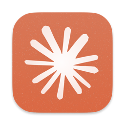

<div align="center">
  
  <h1>Claude Desktop on NixOS</h1>
  <p>Official Anthropic Claude Desktop Linux application packaged natively for NixOS</p>

  <p>
    <a href="https://github.com/B-Shinchan/claude-desktop-nixos/actions/workflows/ci.yml"></a>
    <a href="https://github.com/B-Shinchan/claude-desktop-nixos/actions/workflows/update.yml"></a>
    <a href="https://nixos.org"></a>
    <a href="https://wayland.freedesktop.org/"></a>
    <a href="./LICENSE"></a>
  </p>
</div>

---

Community packaging of **Anthropic's official Linux application** for NixOS. The application comes from the vendor's Debian repository; this project adapts its runtime and desktop integration for NixOS. It is not an official Anthropic or NixOS project.

## Requirements and scope

- `x86_64-linux` only. This repository does not currently package ARM releases.
- Nix with the `nix-command` and `flakes` features enabled.
- A graphical Linux session, working graphics drivers, and a session D-Bus.
- A running Secret Service provider, such as GNOME Keyring or KeePassXC with Secret Service enabled. The launcher selects `gnome-libsecret`; your login session must unlock the keyring.
- A working XDG Desktop Portal and the backend recommended by your desktop or compositor for file dialogs and applicable sharing features.
- A vendor account and any subscription required for the application features you use.

The package installs standard desktop files and vendor icons for Linux application menus. GNOME, Niri, Hyprland, and other desktops have different portal, keyring, shortcut, and window-grouping behavior. They are not all exercised by CI. Current Electron's automatic display selection is used: native Wayland in an appropriately configured Wayland session, X11 otherwise. Pass `--ozone-platform=x11` when troubleshooting.

See the [vendor's Linux documentation](https://support.claude.com/en/articles/10065433-install-claude-desktop) for upstream requirements and feature restrictions. This package cannot enable features unavailable in the upstream application or your plan.

## Try it

```sh
nix run github:B-Shinchan/claude-desktop-nixos
```

For a temporary shell:

```sh
nix shell github:B-Shinchan/claude-desktop-nixos -c claude-desktop
```

These commands provide the executable for that invocation. Install declaratively for persistent application-menu and URI-handler integration.

The default package wraps the application in `buildFHSEnv` and supplies QEMU, OVMF firmware, virtiofsd, Bubblewrap, socat, and OpenSSH at the paths expected by Cowork. A lighter package without this FHS wrapper is also available:

```sh
nix run github:B-Shinchan/claude-desktop-nixos#pure
```

Cowork also needs host virtualization support and access to KVM/VSOCK devices. Providing the runtime tools does not verify Cowork's account-dependent VM workflow.

## Install with a system flake

Add the repository to your existing flake's `inputs` and pass `inputs` to your NixOS modules using `specialArgs`. The following shows the relevant structure; keep your existing host modules and settings:

```nix
{
  inputs = {
    nixpkgs.url = "github:NixOS/nixpkgs/nixos-unstable";
    claude-desktop.url = "github:B-Shinchan/claude-desktop-nixos";
  };

  outputs = inputs@{ nixpkgs, ... }: {
    nixosConfigurations.YOUR_HOST = nixpkgs.lib.nixosSystem {
      system = "x86_64-linux";
      specialArgs = { inherit inputs; };
      modules = [ ./configuration.nix ];
    };
  };
}
```

In a NixOS module:

```nix
{ inputs, pkgs, ... }:
{
  environment.systemPackages = [
    inputs.claude-desktop.packages.${pkgs.stdenv.hostPlatform.system}.default
  ];
}
```

The flake's package set explicitly permits the proprietary application. If you use `overlays.default` instead, permit the unfree package in your own Nixpkgs configuration. The overlay provides `pkgs.claude-desktop` and `pkgs.claude-desktop-fhs`.

For Home Manager, pass `inputs` through `extraSpecialArgs` (or `home-manager.extraSpecialArgs` in a NixOS integration), then put the same package expression in `home.packages`.

Both standalone installation methods use this repository's `flake.lock`. You may set `claude-desktop.inputs.nixpkgs.follows = "nixpkgs"` to share your system's package set, but that dependency combination is not the exact one checked by this repository's CI.

For Cowork, a typical NixOS configuration also includes:

```nix
{
  boot.kernelModules = [ "vhost_vsock" ];
  users.users.YOUR_USER.extraGroups = [ "kvm" ];
}
```

Reboot or start a new login session after changing kernel modules or group membership. Hardware virtualization must be enabled in firmware. Check `/dev/kvm`, `/dev/vhost-vsock`, and your user's access if VM startup fails.

## Desktop integration and troubleshooting

The application-menu name is **Claude**. The desktop file is `com.anthropic.Claude.desktop`, the icon theme name is `claude-desktop`, and the executable is `claude-desktop`. Desktop action commands also point to the packaged launcher. Installing the package advertises its supported URI schemes; it does not guarantee your desktop selects it as the default handler.

Check browser sign-in callbacks:

```sh
xdg-mime query default x-scheme-handler/claude
# If no appropriate handler is selected:
xdg-mime default com.anthropic.Claude.desktop x-scheme-handler/claude
```

If the application is missing from your menu, start a new desktop session after declarative installation. Duplicate entries may come from older manually installed desktop files in `~/.local/share/applications`; inspect them before removing anything. The package does not register itself as a handler for ordinary HTTP or HTTPS links.

For login persistence, verify that a Secret Service provider is running and unlocked. On a standalone compositor, configure keyring startup and PAM unlocking for your actual login method. GNOME normally supplies this session integration. For file-dialog or sharing problems, check your compositor's portal configuration and D-Bus environment. Packaging the libraries alone cannot provide a correctly configured desktop session.

For display problems, try:

```sh
claude-desktop --ozone-platform=x11
```

X11 fallback requires X11/XWayland support. Native Wayland requires a working Wayland session. CI checks a headless X11 launch and a real Wayland surface/application ID in private Weston; it does not certify live Wayland window grouping, rendering, authentication, audio, screen sharing, or subscription-dependent features.

## Automatic updates

Every **Monday at 09:47 IST**, GitHub Actions checks Anthropic's stable amd64 APT feed. GitHub may start scheduled jobs late. Changes to the updater also start a check, and maintainers can use **Actions → Check & Update Upstream → Run workflow**.

The update process:

1. Selects the highest Debian version for the exact package and architecture, validates its download layout, and records its SHA256. It rejects downgrades and conflicting metadata, and detects a changed archive hash for the same version.
2. Evaluates and builds the candidate against the locked Nixpkgs revision. It runs updater tests, desktop-file/icon checks, formatting/workflow checks, an isolated headless version check, X11 window-class matching, and a headless Wayland window/identity check.
3. On the first Monday of each month, also refreshes the official NixOS/Nixpkgs lock pin and validates that candidate with the same checks.
4. After every check succeeds, a separate fresh job reconstructs only the validated version/hash and restricted Nixpkgs lock changes and commits them to `main` as `github-actions[bot]`. Only this job has repository write permission.

A failed candidate is not published. The failed Actions step and job summary explain the failure. Unchanged releases produce no package commit. Action dependencies are pinned to exact commits; Dependabot proposes weekly updates to those pins for security review.

This automates routine application releases, not every future packaging change. Vendor layout, dependency, patch, API, or licensing changes can require maintenance. Nixpkgs inputs are pinned between the monthly validated refreshes. The publisher rejects a lock candidate that changes another input, changes the NixOS repository, moves the pin timestamp backwards, or changes the input graph. GitHub can disable schedules after 60 days without repository activity, and service/account limits can interrupt jobs.

Users receive repository updates when they refresh their own flake lock and rebuild or update their profile. For example, from the system flake directory:

```sh
nix flake update claude-desktop
sudo nixos-rebuild switch --flake .#YOUR_HOST
```

## Development and security

See [CONTRIBUTING.md](CONTRIBUTING.md) for local checks, contributions, and the remaining work before a potential Nixpkgs submission. See [SECURITY.md](SECURITY.md) for trust boundaries, maintenance limits, and branch-protection guidance.

The automated checks exercise the packaging and selected runtime behavior. They are not a complete graphical test matrix, a vendor-binary security audit, or proof of a reproducible upstream build.

## Companion applications

This package is part of a suite of official vendor AI applications packaged for NixOS:

| Application | Command | Repository |
| :--- | :--- | :--- |
| **Claude Desktop** | `claude-desktop` | [claude-desktop-nixos](https://github.com/B-Shinchan/claude-desktop-nixos) |
| **ChatGPT Desktop** | `chatgpt` | [chatgpt-desktop-nixos](https://github.com/B-Shinchan/chatgpt-desktop-nixos) |
| **Google Antigravity IDE** | `antigravity-ide` | [antigravity-nixos](https://github.com/B-Shinchan/antigravity-nixos) |
| **Google Antigravity Hub** | `antigravity-hub` | [antigravity-hub-nixos](https://github.com/B-Shinchan/antigravity-hub-nixos) |

## License and attribution

The packaging code is [MIT-licensed](LICENSE). The application, bundled components, names, and logos remain subject to their respective vendor licenses and trademark rights. Packaging does not grant permission to redistribute proprietary binaries. This project is not affiliated with or endorsed by Anthropic.
